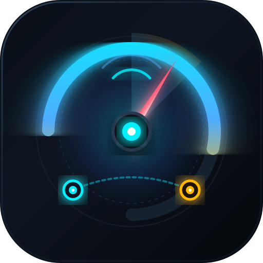

# ⚡ RadarFlow · Copiloto de Velocidade Média

<div align="center">
  
  <p><strong>Monitoramento inteligente de trechos com radar de velocidade média, integração Waze & Maps e Janela Flutuante (Picture-in-Picture).</strong></p>
</div>

---

## 🚀 Funcionalidades

- **Cálculo de Média em Tempo Real:** Monitora a velocidade média precisa dentro do trecho (Ponto A até Ponto B).
- **Velocidade Máxima no Restante:** Calcula a velocidade máxima que você pode atingir nos metros restantes sem ultrapassar o limite da via.
- **Alertas Sonoros & Voz (PT-BR):**
  - Alerta antecipado 500m antes do Ponto A.
  - Alerta ao entrar no trecho.
  - Alertas automáticos ao ultrapassar a média permitida.
  - Relatório por voz ao concluir o trecho.
- **Janela Flutuante (Picture-in-Picture):** Projeta um mini-painel flutuante sobre o Waze e Google Maps no smartphone.
- **Aba de Trajetos & Endereços:** Digite endereço de partida (ou use GPS atual) e destino com busca inteligente e botões diretos para abrir no Waze e Google Maps.
- **PWA (Progressive Web App):** Instalável na tela inicial do celular com funcionamento offline.
- **Keep Screen Awake (Wake Lock):** Não deixa a tela do celular apagar enquanto você dirige.

---

## 🛠️ Como Rodar Localmente

### Opção 1: Windows (Automático)
Dê um duplo clique no arquivo `start-server.bat`.

### Opção 2: Terminal
```bash
node server.js
```
Ou com Python:
```bash
python -m http.server 8000
```
Acesse: `http://localhost:8000`

---

## ☁️ Deploy na Vercel

Este projeto já está configurado para deploy imediato e automático na Vercel com suporte a HTTPS (essencial para a API de Geolocalização/GPS no celular).

Arquivos de configuração incluídos:
- `vercel.json`
- `package.json`
- `manifest.json` e `sw.js`
